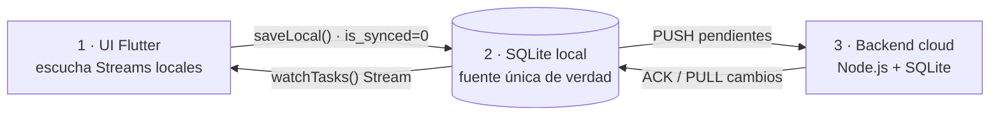

# 01 · Arquitectura Offline-First

## Pregunta detonante

> **¿Cómo resolvemos colisiones de datos cuando la app se utiliza sin conexión a internet y luego se reconecta?**

Respuesta implementada en este proyecto:

1. **La app nunca escribe directo a la nube.** Toda escritura va primero a SQLite y queda marcada con `is_synced = 0` (bandera sucia).
2. **Cada registro lleva metadatos de sincronización**: `id` UUID generado en el cliente, `updated_at` en UTC, `is_deleted` (borrado lógico) y `version` (contador del servidor).
3. **Al reconectar** se ejecuta un ciclo **PUSH → ACK → PULL → MERGE**.
4. **Las colisiones se resuelven con Last-Write-Wins** (`updated_at` más reciente gana) y **se detectan con control de versiones** (`base_version` contra `version`). Cada colisión queda registrada en la tabla `conflicts` del servidor, visible en la consola nube.
5. **Reintentar es seguro**: el UUID del cliente y el `updated_at` hacen idempotente el PUSH. Si la red se cae a mitad de ciclo, repetirlo no duplica nada.

## Diagnóstico: fallas sin estrategia Offline-First y su solución

| Falla | Causa | Solución en este proyecto |
|---|---|---|
| **Pérdida de capturas** | El cambio solo vivía en memoria y se perdía si fallaba la red | `saveLocal()` persiste en disco **antes** de cualquier petición HTTP |
| **Bloqueo de interfaz** | La pantalla esperaba la respuesta HTTP | La UI solo escucha `Stream`s de SQLite (latencia percibida ≈ 0 ms); la red corre en segundo plano |
| **Sobrescritura ciega** | El último en subir pisaba datos más recientes | LWW por `updated_at`, `version` por registro y registro de colisiones |

## Flujo Single Source of Truth



**Regla de oro:** la UI **jamás** lee de la red. Cuando llegan datos de la nube, se escriben en SQLite y el `Stream` actualiza la pantalla.

## Capas del código (`app/lib`)

```
lib/
├── main.dart                      # Inicializa WorkManager y AppServices
├── app.dart                       # MaterialApp + AuthGate (login ↔ tareas)
├── core/
│   ├── app_services.dart          # Raíz de composición y disparadores de sync
│   ├── config.dart                # API_URL (--dart-define), timeouts, debounce
│   └── time.dart                  # ISO-8601 UTC y marca monótona
├── data/
│   ├── models/task.dart           # Entidad + toMap/fromMap + JSON remoto
│   ├── local/app_database.dart    # Esquema SQLite (Paso 2)
│   ├── local/task_local_datasource.dart  # saveLocal, Streams, ACK, MERGE (Paso 3)
│   ├── remote/api_client.dart     # Cliente REST (auth, push, pull)
│   ├── secure/token_storage.dart  # Token cifrado (flutter_secure_storage)
│   └── repositories/              # TaskRepository (UI) y AuthRepository
├── sync/
│   ├── connectivity_service.dart  # Paso 4: connectivity_plus
│   ├── background_sync.dart       # Paso 5: WorkManager + callbackDispatcher
│   ├── sync_repository.dart       # Paso 6: PUSH → ACK → PULL → MERGE
│   └── conflict_resolver.dart     # Estrategia LWW (función pura y probada)
└── ui/                            # login, lista, banner offline, editor
```

## Stack: programa vs. ecosistema Flutter

| Capa técnica | Referencia del temario | Paquete usado | Versión* |
|---|---|---|---|
| Base de datos local | Room Database / SQLite | `sqflite` + `path` | ^2.4.2 / ^1.9.1 |
| Tareas en segundo plano | WorkManager Android | `workmanager` | ^0.10.0 |
| Monitor de conectividad | ConnectivityManager | `connectivity_plus` | ^7.0.0 |
| Identificadores únicos | UUID / timestamps | `uuid` | ^4.5.1 |
| Cifrado en reposo | Keystore / Keychain | `flutter_secure_storage` | ^11.0.0 |
| CRUD nube | REST | `http` | ^1.5.0 |

\* **Diferencia con el PDF:** la diapositiva del Paso 1 lista `workmanager ^0.5.2` y `connectivity_plus ^6.0.5`. `workmanager 0.5.x` usa la *v1 embedding* de Android, que Flutter eliminó, así que **ya no compila** con Flutter actual. Se actualizó a las versiones vigentes (noviembre de 2026) sin cambiar la API conceptual: `registerOneOffTask`, `Constraints(networkType: NetworkType.connected)` y `onConnectivityChanged` con `List<ConnectivityResult>` funcionan igual que en las diapositivas.

## Backend cloud (`backend/`)

Para que el proyecto se pueda ejecutar y evaluar completo en el laboratorio, sin depender de credenciales de un proyecto Firebase, se incluye un backend propio:

- **Node.js ≥ 22.13 sin dependencias externas** (`node:http`, `node:sqlite`, `node:crypto`). No requiere `npm install`.
- **Autenticación** con contraseñas hasheadas con scrypt y tokens **JWT HS256**.
- **Reglas de seguridad por UID**: cada consulta se filtra por el usuario del token.
- **Sincronización idempotente** con LWW, control de versiones y cursor de revisión.
- **Consola nube** (`/console`) protegida con Basic Auth para validar en vivo la subida automática (escenario 3).

Las reglas equivalentes para Firestore están documentadas en [04-seguridad.md](04-seguridad.md#equivalente-en-firebase-firestore-rules), por si se migra a Firebase.
