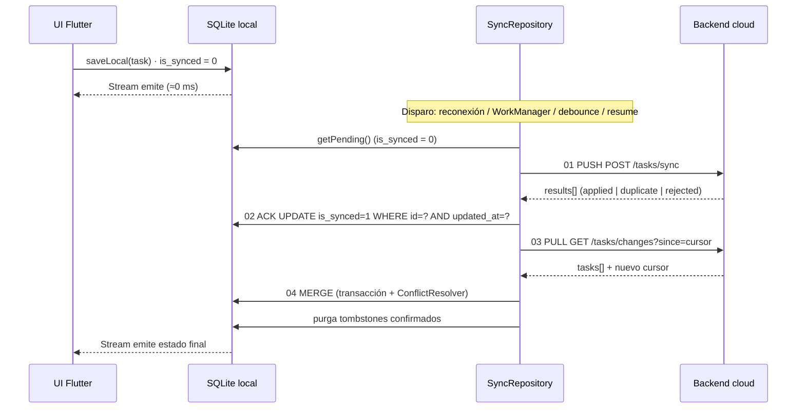

# 03 · Sincronización bidireccional y colisiones

## Ciclo PUSH → ACK → PULL → MERGE (Paso 6)

Implementado en [`sync_repository.dart`](../app/lib/sync/sync_repository.dart) y [`syncService.js`](../backend/src/syncService.js).



| Fase | Qué hace | Detalle clave |
|---|---|---|
| **01 PUSH** | Envía los registros con `is_synced = 0` en lotes de 200 | Incluye borrados lógicos y envía `base_version`. |
| **02 ACK** | Marca `is_synced = 1` lo confirmado | **Condicional**: `WHERE updated_at = <el enviado>`. Si el usuario editó el registro mientras viajaba, sigue pendiente y no se pierde la edición. |
| **03 PULL** | Descarga cambios remotos desde el último `rev` | Paginado (`has_more`); el cursor se guarda en `sync_meta`. |
| **04 MERGE** | Integra cada registro remoto | Dentro de **una transacción SQLite**, para que ninguna edición del usuario se cuele entre la lectura y la escritura. |

## Estrategias contra colisiones

### Last-Write-Wins (LWW)

- **Marca temporal:** se compara `updated_at` en UTC, con precisión de microsegundos tanto en Dart como en Node (`normalizeIso`).
- **Resolución directa:** prevalece el cambio más reciente.
- **Dónde:** en el servidor (al recibir un PUSH) y en el cliente ([`ConflictResolver`](../app/lib/sync/conflict_resolver.dart), al hacer MERGE).

Tabla de decisión del cliente (MERGE):

| Local | Remoto | Decisión |
|---|---|---|
| No existe | cualquiera | `insertRemote` |
| Sin cambios pendientes (`is_synced = 1`) | cualquiera | `overwriteWithRemote` (la nube es la referencia) |
| Pendiente, `updated_at` **más reciente** | más antiguo | `keepLocal` (se subirá en el próximo PUSH) |
| Pendiente, `updated_at` más antiguo o igual | más reciente o igual | `overwriteWithRemote` (empate = ACK perdido) |

Decisión del servidor (PUSH):

| Situación | Resultado |
|---|---|
| UUID nuevo | `applied`, `version = 1` |
| UUID de otro usuario | `forbidden` |
| `updated_at` igual al guardado | `duplicate` (idempotente, no re-versiona) |
| `updated_at` más reciente | `applied`, `version + 1` |
| `updated_at` más antiguo | `rejected` + se devuelve la copia de la nube + se registra la colisión |

### Control de versiones

- **Contador incremental:** `version` por registro; el servidor lo incrementa en cada escritura aceptada.
- **Detección exacta:** el cliente envía `base_version` (la última versión que vio). Si `base_version < version` del servidor, otro dispositivo editó el registro en paralelo. La colisión se registra en la tabla `conflicts` con el ganador, aunque LWW la resuelva a favor del cliente.
- **Caso ideal:** inventarios y saldos. Este proyecto usa LWW para **resolver** y versiones para **detectar y auditar**. Para datos críticos, el mismo `base_version` permitiría rechazar en lugar de resolver: devolver `409` y pedir al usuario que elija.

### Ejemplo de colisión

```
t0  Celular y tablet tienen la tarea v1 "Comprar 10 cajas"
t1  Celular (offline) edita → "Comprar 12 cajas", updated_at=10:05, base_version=1
t2  Tablet (online)   edita → "Comprar 15 cajas", updated_at=10:07 → servidor v2
t3  Celular reconecta → PUSH: 10:05 < 10:07 → rejected, conflict=true
    servidor registra conflicts(winner=server, base_version 1 → server version 2)
t4  Celular hace MERGE: su copia pendiente es más vieja → adopta "Comprar 15 cajas"
```

## Disparadores de sincronización

| Disparador | Dónde | Cuándo |
|---|---|---|
| **Reconexión** (Paso 4) | `ConnectivityService` | `onConnectivityChanged` pasa de `none` a Wi-Fi o datos |
| **Escritura local** | `AppServices._onLocalChange` | Debounce de 800 ms si hay red, y además agenda una tarea única de WorkManager |
| **WorkManager one-off** (Paso 5) | `BackgroundSync.scheduleOneOff` | Con `NetworkType.connected`, **aunque la app esté cerrada**. Política `replace`, segura porque el ciclo es idempotente |
| **WorkManager periódico** | `BackgroundSync.schedulePeriodic` | Cada 15 min (mínimo de Android) con red |
| **Volver a primer plano** | `TasksPage.didChangeAppLifecycleState` | Refresca los Streams (el isolate de fondo pudo escribir) y sincroniza |
| **Manual** | Menú «Sincronizar ahora» / pull-to-refresh | A petición del usuario |

Si varios disparadores coinciden, `SyncRepository.sync()` **reutiliza el ciclo en curso** (`_inFlight`) en lugar de lanzar otro en paralelo.

## Robustez ante fallos

| Falla | Comportamiento |
|---|---|
| Red cae durante el PUSH | Nada se marcó; el próximo ciclo reenvía y el servidor responde `duplicate` para lo que sí llegó. |
| App muerta tras el PUSH, antes del ACK | Igual que arriba: idempotencia por UUID + `updated_at`. |
| Usuario edita mientras sube | El ACK condicional no aplica; el registro sigue pendiente con la edición nueva. |
| Reloj del dispositivo atrasado | `Task.edit()` usa `max(ahora, updated_at_previo + 1 ms)`. |
| Reloj adelantado (intento de «ganar siempre») | El servidor rechaza `updated_at` con más de 5 min en el futuro. |
| Token expirado | `401` → se borra el token, **se conservan** los datos y pendientes; al volver a entrar el mismo usuario, se sincronizan. |
| Hay interfaz de red pero no internet | La petición falla con `NetworkException`, el dato sigue en SQLite y WorkManager reintenta con backoff exponencial. |
